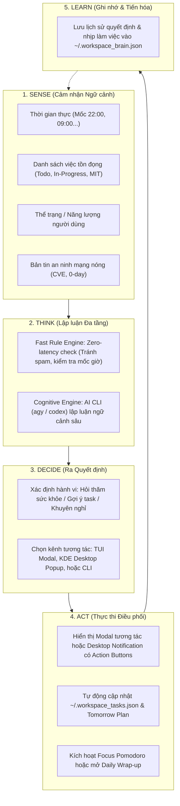
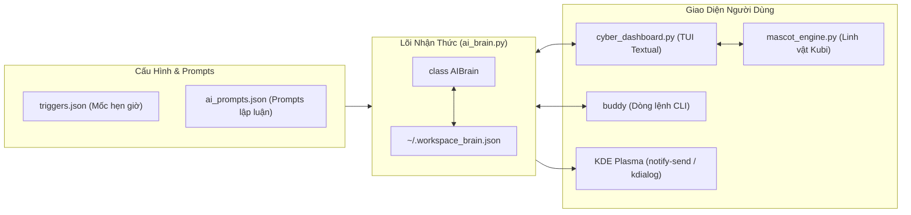
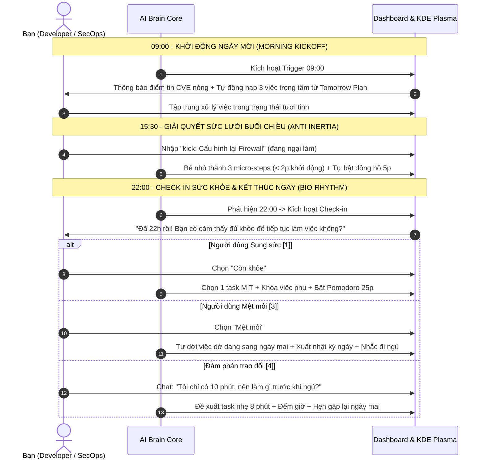

# KẾ HOẠCH TRIỂN KHAI: AI BRAIN - HỆ THỐNG TỰ ĐIỀU PHỐI KHÔNG GIAN LÀM VIỆC
> **Dự án:** Terminal Workspace & Cyber Dashboard (Kubuntu / KDE Plasma)  
> **Tác giả:** cheaterdxd  
> **Mục tiêu:** Nâng cấp Workspace thành một **AI Brain (Bộ Não Nhận Thức Tự Điều Phối)** chủ động, đồng hành theo nhịp sinh học và sức khỏe, có khả năng hẹn giờ, trigger sự kiện và trao đổi 2 chiều về tác vụ.

---

## 🌟 1. Tổng Quan & Triết Lý Chuyển Đổi

### 1.1. Từ "Công Cụ Bị Động" Sang "AI Brain Chủ Động"
Hiện tại, Terminal Workspace là một bảng điều khiển đa năng nhưng thuần túy **thụ động (Passive)**: hệ thống chỉ phản hồi khi người dùng gõ lệnh hoặc bấm phím tắt (`a` thêm việc, `v` tóm tắt tin, `k` phá băng, `p` đếm giờ).

**AI Brain** biến workspace thành một **người đồng hành thông minh chủ động (Autonomous Cognitive Companion)**:
* Không chờ đợi người dùng mà **tự giác quan sát ngữ cảnh**: thời gian trong ngày (sáng, chiều, 22h đêm), khối lượng công việc còn tồn đọng, thể trạng người dùng, và các tin tức an ninh mạng khẩn cấp.
* Chủ động tương tác đúng thời điểm (đặc biệt là **mốc 22:00 đêm**) để khảo sát thể trạng, giao việc vừa sức, hoặc can thiệp chống làm việc kiệt sức (burnout prevention).
* Cho phép **đàm phán, trao đổi tác vụ 2 chiều** ("Tôi chỉ có 15 phút thì nên làm gì?").
* Hoạt động đa tầng: cả trong giao diện dòng lệnh TUI, trên desktop KDE Plasma (thông báo tương tác có nút bấm `notify-send -A` / `kdialog`), và ngoài terminal qua CLI `buddy`.

| Tiêu chí | Mô hình Cũ (Passive Dashboard) | Mô hình Mới (AI Brain Orchestrator) |
| :--- | :--- | :--- |
| **Cơ chế kích hoạt** | Bị động chờ phím bấm / lệnh gõ | **Chủ động Trigger** theo mốc giờ (22:00, 09:00) & sự kiện hệ thống |
| **Quản lý công việc** | Danh sách việc phẳng, người dùng tự chọn | **Tự điều phối thích ứng (Adaptive Triage)** theo thể trạng & thời gian |
| **Bảo vệ sức khỏe** | Không có (dễ thức khuya, kiệt sức) | **Nhận biết giờ đêm (22:00)**, khảo sát độ mệt mỏi, dời việc sang mai và nhắc đi ngủ |
| **Giao tiếp tác vụ** | Một chiều (lưu/sửa JSON tĩnh) | **Hội thoại 2 chiều:** Đàm phán, tư vấn thời lượng, tự động tái cơ cấu to-do |
| **Phạm vi hiển thị** | Chỉ khi đang mở cửa sổ terminal | **Toàn diện:** TUI Textual + KDE Plasma Desktop Popup + CLI ngoài |

---

## 🧠 2. Vòng Lặp Nhận Thức Khép Kín (Cognitive Loop)

AI Brain vận hành theo một chu trình 5 giai đoạn liên tục:



---

## 🎯 3. Ba Trục Tác Động Trọng Tâm

### 3.1. Trục 1: Điều Phối Nhịp Sinh Học & Sức Khỏe (Mốc 22:00 Đêm)
* **Vấn đề giải quyết:** Lập trình viên và chuyên viên bảo mật thường bị cuốn vào công việc ban đêm, thức khuya gây giảm hiệu suất và kiệt sức lâu dài.
* **Cơ chế can thiệp lúc 22:00:**
  * Đúng 22:00, hệ thống kích hoạt thông báo hỏi thăm: *"Bây giờ đã 22h rồi! Bạn có cảm thấy đủ khỏe để tiếp tục làm việc không?"*.
  * **Trường hợp 1 — Người dùng chọn "😴 Mệt mỏi / Cần nghỉ ngơi":**
    * Brain chủ động dời toàn bộ các việc còn dang dở sang **Kế hoạch Ngày Mai (Tomorrow's Plan)** mà không gây áp lực điểm tiến độ.
    * Tự động tổng kết ngày (Daily Wrap-up), xuất file nhật ký `~/work_logs/daily_YYYY-MM-DD.md`.
    * Linh vật Kubi chuyển sang biểu cảm đi ngủ `( ˘ω˘ )zzZ` và khuyên người dùng đóng máy nghỉ ngơi.
  * **Trường hợp 2 — Người dùng chọn "💪 Còn sung sức":**
    * Brain rà soát danh sách task, chọn **duy nhất 1 việc trọng tâm (MIT)** có giá trị cao nhất.
    * Kích hoạt phiên Focus 25 phút để dứt điểm trong khung thời gian giới hạn, ngăn ngừa việc thức thâu đêm.
  * **Trường hợp 3 — Người dùng chọn "☕ Vừa sức":**
    * Brain lọc các task nhẹ: đọc 1 bài phân tích Threat Intel, xem lại ghi chú, dọn dẹp task nhỏ dưới 15 phút.

### 3.2. Trục 2: Phân Bổ & Giao Việc Thích Ứng (Adaptive Task Delegation)
* Tự động gán nhãn tải nhận thức (Cognitive Load) cho công việc:
  * `HIGH`: Lập trình tính năng mới, giải quyết bug phức tạp, phân tích kỹ thuật sâu lỗ hổng CVE.
  * `MEDIUM`: Review code, viết tài liệu, đọc báo cáo bảo mật, cấu hình hệ thống.
  * `LOW`: Commit git, dọn dẹp thư mục, cập nhật to-do list, kiểm tra backup.
* Khi thể trạng thay đổi, AI Brain tự động lọc và gợi ý công việc có tải nhận thức tương thích.

### 3.3. Trục 3: Đàm Phán & Trao Đổi Tác Vụ 2 Chiều (Interactive Dialogue)
* Không giới hạn ở việc bấm nút chọn sẵn, người dùng có thể trò chuyện trực tiếp với AI Brain qua ô chat trong Modal hoặc Omnibar:
  * *Người dùng:* "Tôi chỉ còn 15 phút trước khi đi ngủ, có nên fix lỗi Tailscale không?"
  * *AI Brain:* "Lỗi mạng Tailscale thường tốn ít nhất 30-45 phút debug routing. Tôi đề xuất bạn dời nó sang sáng mai. Hiện tại bạn nên dành 10 phút review bản tin CISA hôm nay rồi nghỉ ngơi. Bạn đồng ý chứ?"
  * *Xác nhận 1 chạm:* Bấm `[y]` hoặc `[Enter]`, AI Brain tự động thực hiện việc sắp xếp lại danh sách task.

---

## 🏗️ 4. Kiến Trúc Chi Tiết Các Thành Phần Kỹ Thuật



### 4.1. Hạt nhân nhận thức trung tâm (`ai_brain.py`)
Mô-đun Python độc lập, chuẩn hóa hướng đối tượng:
* `class AIBrain`:
  * `load_state() / save_state()`: Quản lý bộ nhớ trạng thái nhận thức tại `~/.workspace_brain.json` (năng lượng gần nhất, lịch sử quyết định, chuỗi streak, trạng thái trigger trong ngày).
  * `gather_context() -> dict`: Tổng hợp ngữ cảnh hệ thống (giờ, thứ, ngày, danh sách task hiện tại, kế hoạch ngày mai, tin tức an ninh mạng nóng).
  * `evaluate_triggers() -> list[dict]`: Kiểm tra các mốc thời gian (22:00, 09:00...) theo cơ chế Fast Rule Engine, tránh trùng lặp.
  * `triage_workload(energy_level, user_input) -> dict`: Áp dụng AI Prompting Engine để phân bổ việc theo thể trạng.
  * `chat_negotiate(message) -> dict`: Đàm phán và trao đổi tác vụ 2 chiều với người dùng.
  * `execute_orchestration(action_plan) -> bool`: Tự động áp dụng kế hoạch vào `tasks.json` và `tomorrow_plan.json`.

### 4.2. Cấu hình mốc giờ & chính sách điều phối (`triggers.json` & `triggers.example.json`)
```json
{
  "schedules": [
    {
      "id": "evening_health_checkin",
      "name": "Kiểm tra sức khỏe & Giao việc buổi tối",
      "time": "22:00",
      "enabled": true,
      "type": "health_checkin",
      "desktop_notify": true
    },
    {
      "id": "morning_kickoff",
      "name": "Khởi động ngày mới & Nạp MIT",
      "time": "09:00",
      "enabled": true,
      "type": "morning_brief",
      "desktop_notify": true
    }
  ],
  "policies": {
    "autonomy_level": "advisory",
    "bedtime_recommendation": "23:00",
    "max_evening_focus_mins": 25
  }
}
```

### 4.3. Mở rộng kho prompt AI (`ai_prompts.json` & `ai_prompts.example.json`)
* Thêm prompt `brain_triage`:
  * Đầu vào: Ngữ cảnh giờ, thể trạng người dùng, danh sách việc tồn đọng.
  * Đầu ra: Lời dặn dò sức khỏe ấm áp của Kubi, hành động đề xuất (`focus_deep`, `focus_light`, `postpone_all_to_tomorrow`), ID task trọng tâm, thời lượng đề xuất (15p/25p).
* Thêm prompt `brain_negotiate`:
  * Xử lý đàm phán tác vụ khi người dùng chia sẻ quỹ thời gian hoặc khúc mắc cá nhân.

### 4.4. Tích hợp giao diện TUI (`cyber_dashboard.py`)
* Vòng lặp timer ngầm kiểm tra `brain.evaluate_triggers()` mỗi 15 giây.
* Hiển thị trạng thái Brain trên giao diện:
  `🧠 AI Brain: [Tự điều phối] │ Mốc kế tiếp: 22:00 (Check-in sức khỏe)`
* Cửa sổ tương tác mới `BrainCheckinModal(ModalScreen)`:
  * Nút bấm khảo sát thể trạng nhanh: `[1] 💪 Sung sức`, `[2] ☕ Vừa phải`, `[3] 😴 Mệt mỏi`.
  * Khung nhập liệu đàm phán tác vụ tự do (Interactive Chat Input).
  * Khung hiển thị kế hoạch hành động của AI (Task Recommendation Card).
  * Phím tắt 1 chạm: `[Enter]` Chấp nhận & Bắt đầu, `[m]` Dời việc sang mai.
* Lệnh Omnibar mới:
  * `brain` / `brain: status`: Xem tổng quan trạng thái nhận thức.
  * `checkin` / `suckhoe`: Mở ngay cửa sổ khảo sát sức khỏe.
  * `triage: <khoe|vua|met>`: Phân bổ việc nhanh theo thể trạng.
  * `brain: chat <nội dung>`: Trò chuyện trực tiếp với Brain.
  * `schedule`: Xem và chỉnh sửa lịch hẹn trigger.

### 4.5. Động cơ linh vật tương tác (`mascot_engine.py`)
* Bổ sung các cảm xúc và câu thoại đồng bộ:
  * `checkin_ask`: Biểu cảm ân cần, hỏi thăm `( ˶•ᴗ•˶ )` / 🩺.
  * `health_tired`: Biểu cảm chia sẻ, nhắc nhở ngủ ngon `( ˘ω˘ )zzZ` / 🍵.
  * `health_energetic`: Biểu cảm hăng hái, sẵn sàng chiến đấu `(ง •̀_•́)ง` / 🔥.

### 4.6. Nâng cấp bộ công cụ CLI (`buddy`)
* `buddy brain`: Xem trạng thái hiện tại của AI Brain.
* `buddy checkin`: Chạy phiên hỏi đáp sức khỏe và tự điều phối tương tác trực tiếp trên terminal ngoài.
* `buddy triage [khoe|vua|met]`: Chạy phân bổ tác vụ nhanh từ CLI.
* `buddy schedule`: Xem danh sách mốc hẹn giờ trigger.
* `buddy daemon --check`: Kiểm tra trigger chạy ngầm (dành cho cron / systemd timer).

### 4.7. Tích hợp nền tảng KDE Plasma Desktop (`setup_brain_daemon.sh`)
* Cung cấp script cấu hình `systemd --user` timer hoặc crontab chạy kiểm tra mỗi phút.
* Đảm bảo đúng 22:00, dù người dùng đang duyệt web, xem phim hay tắt Konsole, một thông báo KDE Plasma (`notify-send -A` có nút bấm [💪 Còn khỏe], [☕ Vừa sức], [😴 Mệt mỏi]) hoặc hộp thoại `kdialog` vẫn xuất hiện đúng giờ để hỏi thăm và hỗ trợ điều phối.

---

## 📅 5. Kịch Bản Một Ngày Thực Tế Cùng AI Brain



---

## 🚀 6. Lộ Trình Triển Khai Kỹ Thuật (Milestones)

* **Cột mốc 1 (Core Engine):**
  - Hiện thực hóa `ai_brain.py` với đầy đủ State Management, Rule Engine, và AI Prompts.
  - Tạo cấu hình mẫu `triggers.example.json` và cập nhật `ai_prompts.json`.
* **Cột mốc 2 (TUI Integration):**
  - Tích hợp vòng lặp kiểm tra trigger vào `cyber_dashboard.py`.
  - Xây dựng giao diện `BrainCheckinModal`, lệnh Omnibar `checkin`, `brain`, `triage`.
  - Cập nhật biểu cảm và câu thoại chăm sóc sức khỏe trong `mascot_engine.py`.
* **Cột mốc 3 (CLI & Desktop Daemon):**
  - Bổ sung lệnh `buddy brain`, `buddy checkin` cho CLI.
  - Tạo script cài đặt `setup_brain_daemon.sh` (systemd user timer + KDE Plasma notify-send).
* **Cột mốc 4 (Verification & Documentation):**
  - Kiểm thử toàn diện các kịch bản (Mock 22h, chọn Sung sức, Mệt mỏi, Đàm phán tác vụ).
  - Cập nhật tài liệu hướng dẫn trong `README.md`.

---

## ✅ 7. Kế Hoạch Kiểm Thử & Nghiệm Thu (Verification Plan)

### 7.1. Automated Tests
1. **Kiểm tra cú pháp cấu hình JSON:**
   ```bash
   python3 -c "import json; json.load(open('triggers.example.json')); print('Triggers JSON OK')"
   python3 -c "import json; json.load(open('ai_prompts.json')); print('AI Prompts JSON OK')"
   ```
2. **Kiểm tra Unit Test lõi AI Brain:**
   ```bash
   python3 -c "
   import ai_brain
   brain = ai_brain.AIBrain()
   ctx = brain.gather_context()
   assert 'time' in ctx and 'tasks' in ctx
   print('AI Brain Context Gathering: PASS')
   "
   ```
3. **Kiểm tra CLI Buddy:**
   ```bash
   ./buddy brain
   ./buddy schedule
   ```

### 7.2. Manual Verification
1. Mở `./dashboard`, gõ `checkin` trong Omnibar: Modal xuất hiện mượt mà.
2. Thử nghiệm chọn `[3] Mệt mỏi`: Kiểm tra các việc dở dang được chuyển sang Kế hoạch Ngày mai, Daily Wrap-up mở ra để lưu nhật ký.
3. Thử nghiệm chọn `[1] Sung sức`: Kiểm tra task trọng tâm được chọn và phiên Focus 25p tự động bắt đầu.
4. Thử nghiệm gõ trao đổi: *"Tôi chỉ có 15 phút thôi, nên làm gì trước khi đi ngủ?"*, kiểm tra câu trả lời tư vấn và hành động giao việc thích ứng của AI.
5. Thử nghiệm trigger tự động: Đặt trigger thử nghiệm vào thời gian hiện tại + 1 phút, xác nhận Modal TUI và thông báo KDE Plasma tự động kích hoạt đúng giờ.
